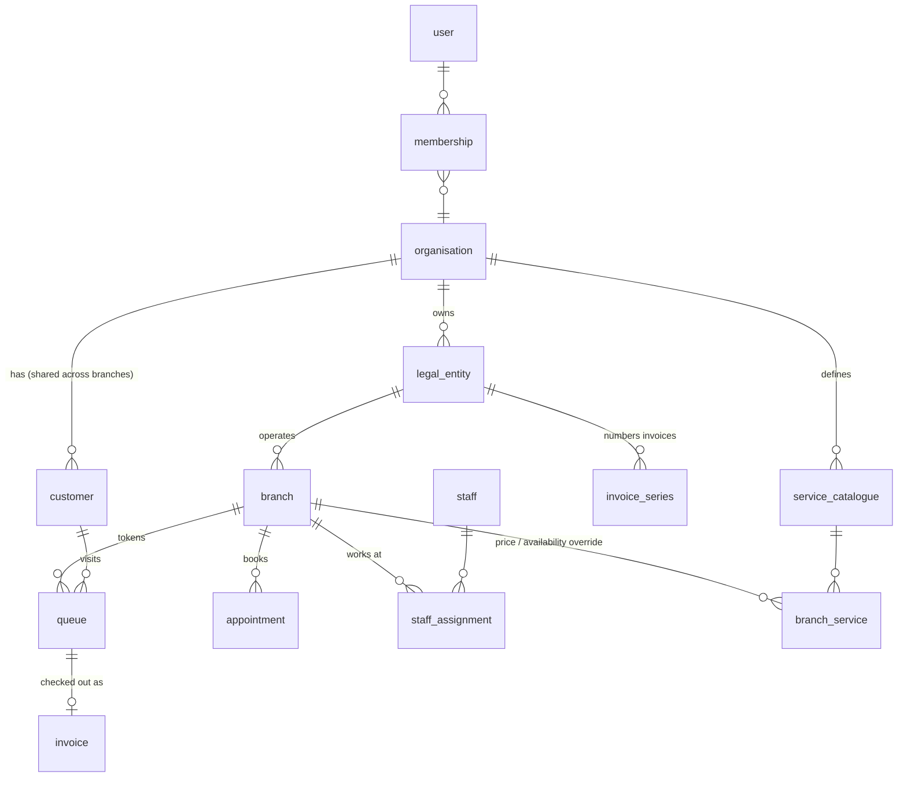

# SalonChain — running many salons on one platform

> **Branch:** `SalonChain` (from `main` @ ebde2f1) · **Status:** design draft for review — no code or database changes yet
> **Rule that governs everything below:** the live MiNiCUTS salon keeps working exactly as it does today. Every step is additive, switchable and reversible. Nothing here writes to production data without Munir's approval.

## 1. The idea in one paragraph

A chain is **one business with one customer base, one brand and one set of rules, operating from several physical salons.** The platform therefore has to answer two questions at the same time: *"how is this one salon doing today?"* (branch view, used by the team on the floor) and *"how is the whole business doing?"* (chain view, used by the owner). The customer belongs to the **business**, not to a salon: a child who earns stamps at Silicon Oasis can redeem the free wash in Mirdif.

## 2. Who uses it, and what they see

| Person | Sees | Typical day |
|---|---|---|
| **Owner** | All branches, side by side | Chain overview, branch comparison, targets, P&L, campaigns |
| **Area / ops manager** | The branches assigned to them | Same as owner, limited to their branches |
| **Branch manager** | Own branch only | Queue, appointments, roster, branch reports, void/discount approval |
| **Stylist / receptionist** | Own branch queue & calendar | Check-in, call, stamp, checkout |
| **Customer (parent)** | Own children, any branch | Passport, stamps, bookings, WhatsApp |

## 3. The building blocks

| Concept | What it holds | Why it is separate |
|---|---|---|
| **Organisation** | Brand, loyalty rules, T&C text + version, WhatsApp templates, default catalogue | One set of rules for the whole chain |
| **Legal entity** | Company name, TRN / GSTIN, country, currency, tax basis, invoice prefix | UAE VAT and Indian GST are filed per company. Invoice numbers must be gap-free **per entity per financial year** |
| **Branch** | Name, code (`DSO`), address, map link, **time zone**, opening hours, chairs, kiosk devices, which legal entity it belongs to | Everything physical and local |
| **Customer** | Child, parent, mobile, dob, area, stamps, T&C consent | Belongs to the organisation; also remembers `home_branch` and `last_branch` |
| **Service catalogue** | One master list; each branch may override **price, duration, availability** | Same "Boys Haircut" everywhere, but Pune may charge differently |
| **Staff assignment** | Who works where and when (home branch + temporary cover) | Stylists can be lent between salons |
| **Membership** | user → role → branches | Drives what each login can see (Section 7) |

MiNiCUTS today = 1 organisation, 1 legal entity (MiNiCUTS FZCO), 1 branch (`DSO`). That is the starting data, and with one branch **no new screen appears**.

## 4. How each part of today's app behaves with many branches

| Today | In a chain |
|---|---|
| **Check-in kiosk** (`minicuts-checkin.html`) | Opens with a branch code (`?b=DSO`) and is paired once to a branch. A parent registered anywhere is recognised by mobile number at any branch. |
| **Token numbers** (global per day) | Restart at 1 **per branch per day**. Unique on (branch, date, token). |
| **Queue & History** | Show the logged-in branch; owner has an "All branches" toggle. |
| **Appointments & slots** | Calendar per branch; stylists listed are that branch's roster. A customer can book any branch. |
| **Checkout & invoices** | Invoice stamped with branch + legal entity. Numbering runs per entity per FY; void numbers are never reused (already true). Seller details (name, TRN/GSTIN, address) come from the entity; the **branch name** goes on the WhatsApp template. |
| **Loyalty & stamps** | Shared across branches by default (setting `loyalty_scope: organisation | branch`). A free wash can be redeemed anywhere; the redemption records **where**, so a settlement report exists if some branches are franchised. |
| **Games, prizes, vouchers** | Rules at organisation level; prize stock and "gifts handed out" tracked per branch. |
| **Services & prices** | Master catalogue + per-branch override. Invoices already snapshot `list_price`, so price changes never rewrite history. |
| **Staff, roster, leave, tips** | Stylist has a home branch; cover shifts at another branch are attributed to the branch where the work happened. Clash warning if rostered at two places. |
| **Reports & Insights** | Every report gets a branch filter. Owner default = all branches; manager is locked to their own. Currency is never silently mixed (see Section 6). |
| **WhatsApp (Zen)** | Templates shared; branch name, address and Google-review link filled per branch. Sender number per organisation, optionally per branch. |
| **Settings** | Two levels: *Chain settings* (loyalty, T&C, templates) and *Branch settings* (hours, kiosk, local prices). |

## 5. What the owner gets that a single-salon app cannot give

1. **Chain overview** — one row per branch: revenue, visits, new vs returning, average bill, rebooking rate, stylist utilisation, free washes open, vs target. Red/amber/green.
2. **Branch comparison** — same KPI, same period, bars side by side; best and worst stylists across the chain.
3. **Cross-branch customer view** — how many children visit more than one branch; "lost" customers per branch; does a new salon cannibalise the old one.
4. **Branch P&L and break-even** — revenue minus rent, salaries, consumables, marketing, per branch per month, with the visits/day needed to break even. *Relevant now: the first salon runs at roughly AED 32K cost against 22–25K revenue. Before copying the model, the platform should show exactly what a branch needs to be profitable.*
5. **Targets** — monthly revenue/visit targets per branch, tracked daily.
6. **Central campaigns, local delivery** — one campaign (birthday, lapsed customers, new-branch launch) targeted by branch or area, using the existing Zen WhatsApp pipeline.
7. **Opening playbook** — "Add branch" wizard: details → pick legal entity → copy catalogue and prices from a template branch → add staff → print kiosk QR → go live checklist.

## 6. The hard cases (decided up front so they do not bite later)

| Case | Proposed handling |
|---|---|
| **Time zones** | Today the code assumes Dubai (UTC+4) in a few places (`dubaiYmd`, Insights, the live-vs-history split). Each branch gets a time zone; "today" and "this week" are computed per branch. India is UTC+5:30. |
| **Two countries / currencies / taxes** | Currency and tax come from the legal entity. Chain totals are shown **per currency** by default; an optional reporting currency uses a rate table the owner maintains. UAE 5% VAT and Indian CGST/SGST are already supported by the invoice engine. |
| **Customer identity** | Keep "mobile + boy/girl" as the key, but scope it to the organisation, so the same child is never duplicated per branch. |
| **Stamps earned in A, redeemed in B** | Allowed. Redemption stores the redeeming branch; an optional monthly settlement report shows what each branch owes/is owed. |
| **Consent & privacy** | T&C acceptance stores *which text version* and *which entity* accepted. UAE (PDPL) and India (DPDP) wording can differ per entity. |
| **Historical data** | `historical_transactions` (the Excel import, up to 8 Jun 2026) is attached to the `DSO` branch. |
| **Franchise vs owned** | Owned branches share data freely. A franchised branch needs stricter isolation, its own P&L and royalty reporting. The model supports both; the choice changes how strict Section 7 must be. |

## 7. Security — be honest about the starting point

Today every page talks to the database with a public key, row-level security is off, and the management code is client-side. That is acceptable for one salon run by the owner. **For a chain it is not**: a branch manager could read another branch's revenue just by calling the API. So:

- **Phase 1–2 (branches as a convenience):** branch separation is in the app only. Fine while every branch is owner-operated and staff are trusted.
- **Phase 3 (real isolation):** Supabase Auth logins, a `membership` table, and row-level security on every table using a helper such as `has_branch_access(branch_id)`. This updates `ADR-0004`, which proposed a tenant id passed to a proxy; with several branches per tenant, per-user membership is the better fit.
- Kiosks are not people: each is paired to one branch with a revocable device key and can only create check-ins for that branch.

## 8. How we get there without touching what works

The rule is **expand → switch → contract**, one reversible step at a time.

| Phase | What changes | Production impact |
|---|---|---|
| **0. Prepare** | Create the new tables (organisation, entity, branch, membership …) and add *nullable* `branch_id` columns. Backfill everything to branch `DSO`. | Additive SQL only. **Needs Munir's explicit approval and a rehearsal first.** |
| **1. Branch-aware app, one branch** | Apps read/write `branch_id`; behind a `multi_branch` flag, off by default. | With the flag off the app looks and behaves as today. |
| **2. Second branch (pilot)** | Add branch #2, pair its kiosk, roster, prices. Branch switcher appears. | Only the new branch is new. |
| **3. Accounts & isolation** | Supabase Auth, roles, RLS, remove the shared key from pages. | The biggest change. Done last, with a rollback plan. |
| **4. Chain analytics** | Chain overview, comparison, targets, P&L, campaigns. | Read-only additions. |
| **5. Platform for other chains** | Zen console becomes the admin plane for onboarding other salon businesses (the same model, other organisations). | Separate from the MiNiCUTS app. |

**Where we test:** the existing DEV project stays untouched. Proposal: a **separate sandbox Supabase project** holding a copy of the schema and generated sample data for 3 pretend branches. Every migration is rehearsed there first, and the existing automated test suites (plus new multi-branch ones) must pass before anything is proposed for production.

## 9. Where the data model changes (Phase 0 detail)

| Table | Change |
|---|---|
| `customers` | + `org_id`, `home_branch_id`, `last_branch_id`, `tc_version`, `tc_entity_id` |
| `queue`, `visits`, `appointments`, `invoices`, `prizes_given`, `game_sessions`, `salon_coupons`, `historical_transactions` | + `branch_id` (backfilled `DSO`); indexes on (branch, date) |
| `queue` | token unique on (`branch_id`, `checkin_date`, `token_number`) |
| `invoices` | + `entity_id`; numbering unique on (`entity_id`, `fy`, `seq`) instead of globally |
| `salon_services` | becomes the master catalogue; new `branch_service` overrides |
| `staff`, `staff_roster`, `staff_leaves` | + `home_branch_id`; new `staff_assignment` for cover |
| `staff_config` (key/value) | + scope (`org` / `entity` / `branch`) so `co_settings`, `loyalty_config`, `booking_config`, `tc_text` resolve branch → entity → organisation |
| new | `organisations`, `legal_entities`, `branches`, `memberships`, `kiosk_devices`, `branch_targets`, `branch_costs` |

## 10. Decisions needed from Munir

1. **Owned or franchised?** Will every future salon be run by MiNiCUTS itself, or will some be franchised? This sets how strict isolation and reporting must be.
2. **Where next?** A second Dubai salon, Pune, or both? India means a separate legal entity, GST invoices, rupees and a different time zone from day one.
3. **Shared stamps?** Should a child's stamps and free wash work at every branch (recommended), or stay per branch?
4. **Same prices everywhere?** One price list for the chain, or per-branch prices?
5. **Sandbox project:** OK to create a separate Supabase sandbox for rehearsals? (Production and DEV stay untouched.)
6. **Scope:** is this for MiNiCUTS only, or should it be designed from day one as the product sold to other salon chains through Zen? (The model above works for both; the second adds onboarding, billing and stricter isolation earlier.)

---

## 11. Built on this branch: outlets, access control, stock and purchasing

**Nothing here is live.** It all sits behind a switch (`?chain=1`); with the switch off the staff app behaves exactly as today. The database script `sql/002_salonchain_core.sql` has **not been applied anywhere** — applying it to production needs Munir's explicit approval, after a rehearsal on a sandbox project.

### Try it without touching anything
Open `minicuts-staff.html?demo=1&chain=1` (practice data lives only in your browser). Tap a practice login (password `demo`): Owner, Controller, Manager DSO, Manager Mirdif, Store keeper, Stylist, Auditor. `?chain=0` switches it off again.

### Who sees what (roles)
| Role | Outlets | Can |
|---|---|---|
| Owner | all | everything, including users and roles |
| Controller | all | oversee stock, suppliers, purchase orders (unlimited approval), audit trail; **not** manage users |
| Area manager | assigned | run the outlets; approve POs up to AED 2,000 |
| Branch manager | own | run the outlet; approve POs up to AED 500 |
| Store keeper | own | receive and issue stock, draft POs, receive goods |
| Receptionist / Stylist | own | queue, appointments, checkout (receptionist), record stock used |
| Auditor | all | read-only |

Each login is a **membership** (e-mail → role → outlets, optional personal PO limit). Owners manage them in *Users & access* (Users, Roles matrix, Outlets).

### Stock
Stock is never typed in directly. Every change is a line in an **append-only ledger**: *incoming* (opening, receipt from a PO, transfer in, adjustment +) and *outgoing* (used in a service, gift, damaged, expired, transfer out, adjustment −). On hand = sum of the ledger; it cannot go below zero. Per outlet and item you set a **reorder point** and **reorder quantity** (optional max level); the screen shows days of cover and a *suggested* reorder point from the last 30 days of use and the supplier lead time. An item is flagged for reorder when **on hand + already on order** ≤ reorder point, so the same thing is never ordered twice.

### Purchase orders
Draft → submitted → approved → ordered → part received / received (or rejected, cancelled, closed short). Numbers are `PO/<outlet>/<year>/<seq>`, assigned by the database. Rules: only people with *approve* rights for that outlet can approve; **never your own order**; never above your limit (the order waits for someone higher — the controller sees a "waiting for you" list). Receiving goods adds the stock to the ledger tied to the PO line, so the order status updates by itself. From the low-stock list one click creates a draft PO per supplier. Print / WhatsApp the order to the supplier once approved.

### Controller overview
One row per outlet: items to reorder / out of stock, stock value, open POs and value, spend this month, orders waiting for approval, and the recent audit trail. Revenue and visits per outlet join this screen once the queue and invoices carry an outlet (Phase 0 migration).

### Honest limits
- **Real protection needs the database step.** Until `sql/002` is applied and staff log in with Supabase Auth, the menus hide things but the database still accepts the shared key. The SQL contains the row-level-security rules, rehearsed in `tests/sql_salonchain.test.mjs` (61 checks).
- Queue, appointments and billing are **not yet per outlet** (they need `branch_id`, a separate approved migration). Discount / void / checkout are hidden by role in the app only.
- Adding a person = create their login in Supabase Auth with the same e-mail, then add them in Users & access.
- Branch managers can transfer stock only between outlets they hold.

### Tests
`node tests/e2e_chain.js` (30 checks, practice mode), `node tests/chain.test.js` (41: rules, reorder maths, PO totals, app roles = database roles), `tests/sql_salonchain.test.mjs` (61, Postgres in WASM). Existing suites unchanged and green.
